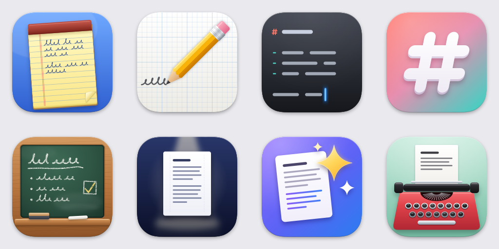

# Opciones de icono

Ocho propuestas para el icono de Scratchpad, cada una con un concepto distinto.



| # | Archivo | Concepto |
|---|---------|----------|
| 1 | [`01-legal-pad.svg`](01-legal-pad.svg) | **Bloc amarillo.** El *scratchpad* literal: un bloc con encuadernación, margen rojo, renglones, letra a mano y la esquina doblada. |
| 2 | [`02-pencil.svg`](02-pencil.svg) | **Lápiz.** El acto de escribir: un lápiz sobre papel cuadriculado dejando un trazo. |
| 3 | [`03-caret.svg`](03-caret.svg) | **Cursor.** Texto plano en un editor oscuro: un encabezado `#`, una lista con viñetas y el cursor azul de la app parpadeando. |
| 4 | [`04-markdown-hash.svg`](04-markdown-hash.svg) | **Markdown.** El `#` de los encabezados en relieve, sobre el degradado coral a turquesa del fondo de la captura. |
| 5 | [`05-slate.svg`](05-slate.svg) | **Pizarra.** Una superficie para escribir, borrar y volver a escribir: pizarra con marco de madera, tiza y borrador. |
| 6 | [`06-focus.svg`](06-focus.svg) | **Enfoque.** El modo sin distracciones y la opción *Center*: una página con la columna de texto centrada, bajo un foco. |
| 7 | [`07-assistant.svg`](07-assistant.svg) | **Asistente.** El panel *LLM Responds*: una nota cuyas últimas líneas las escribió el modelo, con destellos. |
| 8 | [`08-typewriter.svg`](08-typewriter.svg) | **Máquina de escribir.** La escritura monoespaciada: una máquina roja con la hoja saliendo del rodillo. |

Todos siguen la plantilla de iconos de macOS: lienzo de 1024 × 1024, forma
redondeada de esquinas continuas de 824 × 824 centrada (100 px de margen) y la
sombra incluida en el propio dibujo. Así quedan del mismo tamaño que los demás
iconos del Dock. El `AppIcon.svg` actual ocupa todo el lienzo y por eso se ve
más grande que el resto.

Los SVG no usan fuentes externas, así que `rsvg-convert` los renderiza igual
que un navegador.

## Usar una opción

```bash
cd Resources/Icon
cp options/04-markdown-hash.svg AppIcon.svg
./generate_icons.sh AppIcon.svg AppIcon   # necesita macOS (iconutil) y librsvg
```
